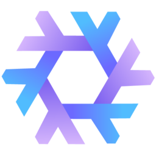

# MisterKartoffel's Nix Flake

 

## Table of Contents
0. [You Are Here](#table-of-contents)
1. [Directory Structure Reference](#directory-structure-reference)
2. [Module Dependencies](#module-dependencies)
3. [Host Specs](#host-specs)
4. [Acknowledgments](#acknowledgments)
5. [Next Steps](#next-steps)
6. [Licensing](#licensing)

## Directory Structure Reference
- [`.tack`](/.tack): Input pinning using [tack](#module-dependencies).
- [`hosts/`](/hosts): Exposed as `nixosConfigurations` in the flake.
  - `<hostname>/`
    - [`default.nix`](/hosts/ghost/default.nix): `<hostname>`'s entrypoint. Every optionally enabled NixOS module is enabled here.
    - [`disko.nix`](/hosts/ghost/disko.nix): Declarative disk formatting powered by [disko](#module-dependencies).
    - `...`
- [`users/`](/users)
  - [`<username>.nix`](/users/mimikyu.nix): `<username>`'s entrypoint. Only used to define installed packages that are not currently in a [hjem](#module-dependencies) module.
- [`modules/`](/modules): Every module that defines something in some module system lies here.
  - [`hjem/`](/modules/hjem): Modules that use [hjem](#module-dependencies) for `$HOME` management. Exposed as `nixosModules.default` in the flake.
  - [`nixos/`](/modules/nixos): Modules from the NixOS module system. Exposed as `hjemModules.default` in the flake.
    - [`preservation/`](/modules/nixos/preservation): System state persistence using [preservation](#module-dependencies).
    - [`sops.nix`](/modules/nixos/sops.nix): Declarative secret management with [sops-nix](#module-dependencies).
    - `...`
- [`pkgs/`](/pkgs): Portable standalone wrapped packages, callable via `nix run github:Nivology/flake#<package>`. Exposed as `packages` in the flake for `x86_64-linux`.
  - [`nushell/`](/pkgs/nushell): Shell of choice. Wrapped via `mkDerivation` with `makeBinaryWrapper`.
  - [`nvim/`](/pkgs/nvim): Editor of choice. Wrapped via `wrapNeovimUnstable` for native Lua configuration.
  - [`zen-browser/`](/pkgs/zen-browser): Browser of choice. Wrapped via `wrapFirefox` using source package from [zen-browser-flake](#zen-browser).
- [`overlays/`](/overlays): Individual per-package or per-package-set overlays. They don't add new packages from [`pkgs/`](/pkgs), they're limited to overriding existing nixpkgs packages. Exposed as `overlays.default` in the flake.
- [`ci/`](/ci): Tools and scripts used for Continuous Integration and git.
  - [`diff.nix`](/ci/diff.nix): Generates an SVG diff from [dix](https://github.com/manic-systems/dix) JSON output. Used in [`tack.yml`](/.github/workflows/tack.yml).
  - [`matrix.nix`](/ci/matrix.nix): Evaluates every `nixosConfigurations` host as a `listOf attrs`. Used in [`flake.yml`](/.github/workflows/flake.yml) and [`tack.yml`](/.github/workflows/tack.yml).
  - [`treefmt.nix`](/ci/treefmt.nix): Sets [treefmt's](https://github.com/numtide/treefmt) configuration, imported via `pkgs.treefmt.withConfig` in the `formatter.${system}` flake output for `x86_64-linux`.
  - `...`
- [`.editorconfig`](/.editorconfig): Sets the minimum expected editor configuration for this repository. Respecting it is expected. For reference, read the [editorconfig](https://editorconfig.org/) website.
- [`.envrc`](/.envrc): [direnv](https://direnv.net/) hook file. Also exports `NH_FLAKE` for [nh](https://github.com/nix-community/nh).
- [`default.nix`](/default.nix): Configures the [flake-compat](https://github.com/NixOS/flake-compat) layer for flakeless consumers. Provides every flake output under `outputs`.
- [`flake.nix`](/flake.nix): The main entrypoint. Uses [adios-flake](#adios-flake) to define and orchestrate every one of its outputs in a self contained form-factor. Does not define its own inputs.
- [`shell.nix`](/shell.nix): Main configuration devShell. Exposes LSPs for internal use and is exposed by the `devShells.${system}.default` flake output for `x86_64-linux`.
- [`README.md`](#table-of-contents): You are here!

## Module Dependencies

  
| Project | Repository | About |
| :-----: | :--------: | ----- |
| **tack** | [manic-systems/tack](https://github.com/manic-systems/tack) | Flake-like toml nix pins, lazily fetched and transformed |
| **adios-flake** | [Mic92/adios-flake](https://github.com/Mic92/adios-flake) | Composable flake outputs using the adios module system |
| **disko** | [nix-community/disko](https://github.com/nix-community/disko) | Declarative disk partitioning and formatting using nix |
| **hjem** | [feel-co/hjem](https://github.com/feel-co/hjem) | Streamlined, elegant $HOME management with Nix |
| **preservation** | [nix-community/preservation](https://github.com/nix-community/preservation) | Nix tooling to enable declarative management of non-volatile system state |
| **sops-nix** | [Mic92/sops-nix](https://github.com/Mic92/sops-nix) | Atomic secret provisioning for NixOS based on sops |
| **Zen Browser** | [youwen5/zen-browser-flake](https://github.com/youwen5/zen-browser-flake) | Nix flake for Zen Browser, with automatic updates |

## Host Specs

| Hostname | Model | CPU | GPU | RAM |
| :------: | :---: | :-: | :-: | :-: |
| [ghost](/hosts/ghost) [^1] | Lenovo IdeaCentre B550 | Intel Core i5-4430 @3GHz | AMD Radeon HD 8570M | 2x4GB DDR3 1600MHz [^2] |

## Acknowledgments
- [Bvngee](https://github.com/bvngee) and [Soi](https://github.com/soulsoiledit), for being a part of TMC and indirectly exposing me to their Nix flakes.
- [EmergentMind](https://github.com/EmergentMind), for being a great reference both on YouTube and on GitHub when it comes to learning Nix and for showing the configuration structure from which I previously stole.
- The [niri & DMS](https://discord.gg/vT8Sfjy7sx) and [Ghostty](https://discord.gg/ghostty) Discord servers for many references.

## Next Steps
You can read all about what's currently planned for this flake by reading the [List of TODOs](https://github.com/orgs/Nivology/projects/2).

## Licensing
This project is licensed under the [Zero Clause BSD](https://opensource.org/license/0bsd) license, which can be read in full on that link you just went past or in [LICENSE](/LICENSE).

[Back to Top](#table-of-contents)

  

[^1]: Yes, it is that bad.
[^2]: Nothing to see here, Sam Altman.
